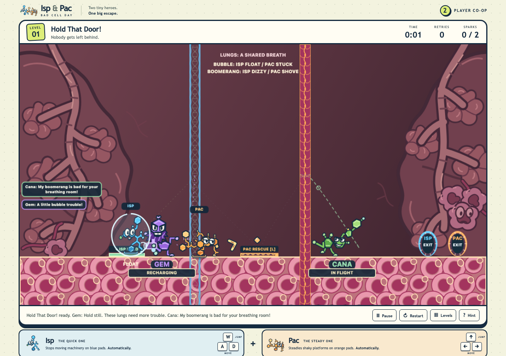
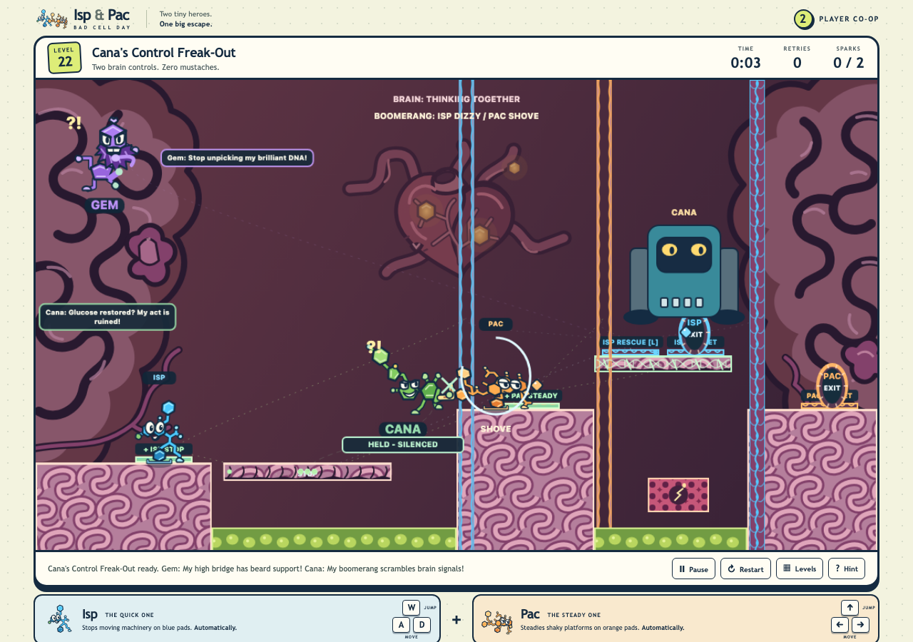
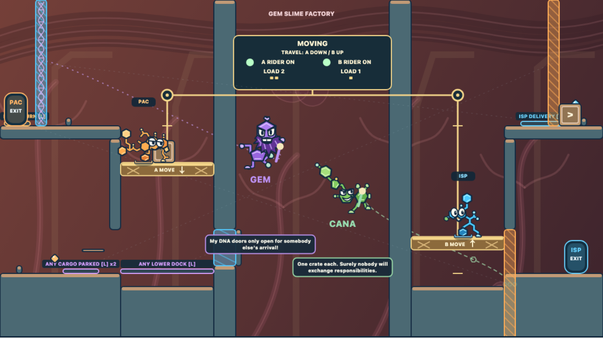
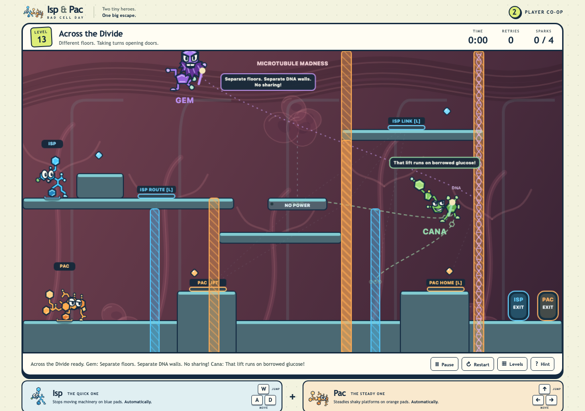
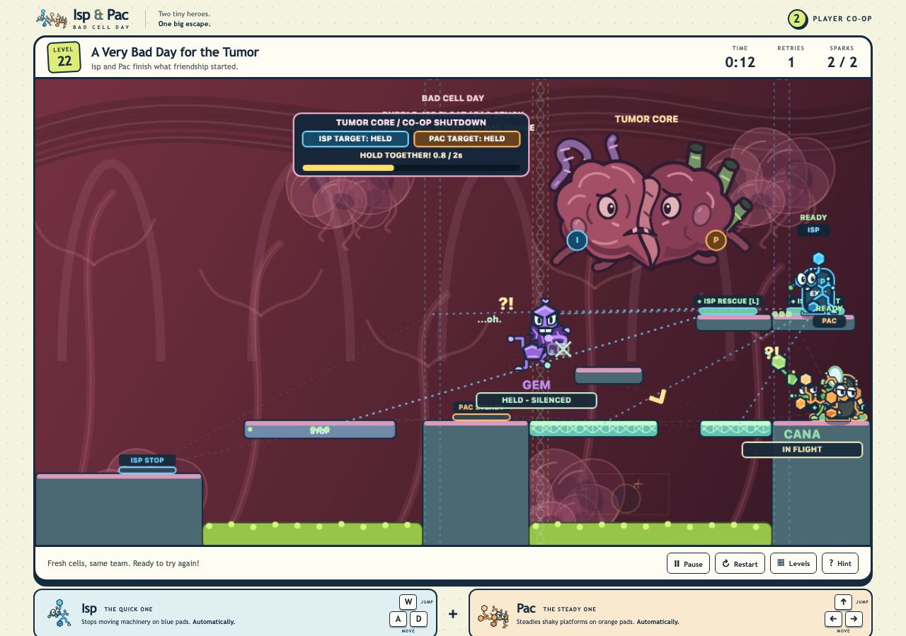

# Isp & Pac: Bad Cell Day

Guide two molecular heroes through lungs, intestine, marrow, liver, brain, and tumor in a cooperative platform puzzle game where every escape takes teamwork on one shared keyboard and recurring villains disrupt the route from the opening room.

## Work together

Isp and Pac have separate routes, switches, and exits. One player may need to hold a door while the
other crosses, reaches a rescue switch, and opens the way back. The campaign builds those handoffs
across 38 rooms, from gentle introductions to reciprocal cargo lifts and a shared tumor-core showdown.

**Pick On Someone Else** (`level_35`) has Cana's target choice direct the cargo onto
one of two reciprocal routes; the heroes catch and return the sac, then trade jobs.

In **Hold That Door!**, Gem can FLOAT Isp off HOLD while Cana's boomerang contests Pac's
crossing. Pac reaches RESCUE to latch a safe route for Isp, then both heroes reach their exits.

<!-- screenshots:begin (managed by screenshot-docs) -->


<!-- screenshots:end -->


Across the Divide splits Isp and Pac between upper and lower routes, where each opens the next
step for the other. In the finale, Isp holds the upper target so Pac can cross and join the shared
shutdown charge.




## Quick start

With Node.js/npm and Python 3 installed, start the local game from the repository root:

```sh
./run_web_server.sh
```

On first run, the script installs the npm dependencies. It builds the GitHub Pages files in `dist/` and serves them locally. Open the `http://localhost:<port>/` address shown in the terminal. Stop the server with Ctrl+C. This is a local preview; it does not publish the game.

## Play

Both players share one keyboard:

| Hero | Move | Jump |
| --- | --- | --- |
| Isp | A and D | W |
| Pac | Left and Right arrows | Up arrow |

Either player can press R to restart a room or Escape to pause. Reach each hero's matching exit; clear a room to unlock the next one. Progress is saved in the browser.

## What is inside

- A 38-room cooperative campaign with five introductory rooms, distinct relay puzzles, reciprocal
  cargo lifts, and a final tumor-core encounter.
- Switches, color gates, moving platforms, hazards, collectibles, crates, and paired routes.
- Original molecular characters: Isp, Pac, and the troublemakers Gem and Cana, whose bubblegun
  and returning boomerang disrupt and sometimes help cooperative routes.
- An optional Troublemaker Trial with Gem's bubble and Cana's boomerang; it leaves campaign progress alone.

## Guides and project notes

- [docs/USAGE.md](docs/USAGE.md) explains game mechanics and the optional trial.
- [docs/LEVEL_DIFFICULTY.md](docs/LEVEL_DIFFICULTY.md) describes campaign order and room difficulty.
- [docs/DESIGN_DECISIONS.md](docs/DESIGN_DECISIONS.md) records the cooperative rules and art direction.
- [docs/E2E_TESTS.md](docs/E2E_TESTS.md) describes browser acceptance checks.

## License

The source code is available under the MIT License: [LICENSE.MIT](LICENSE.MIT).
