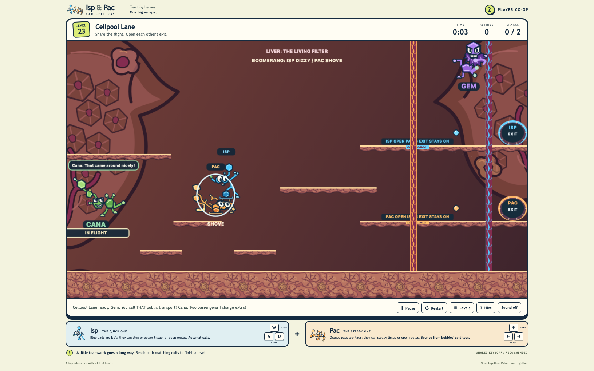
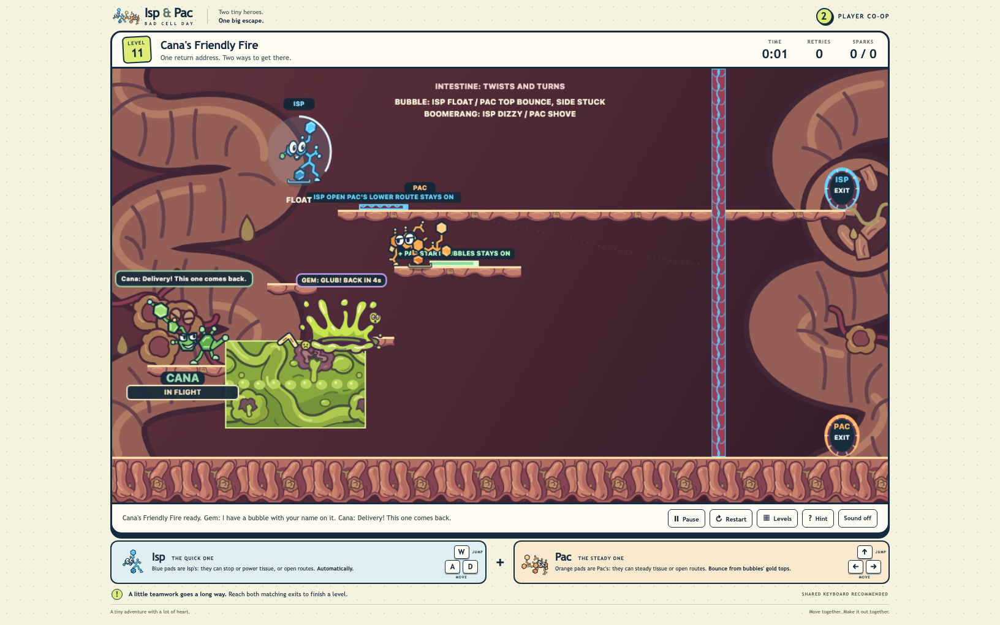

# Isp & Pac: Bad Cell Day

Team up as two molecular heroes in a cooperative platform puzzle through a living tumor, where every escape takes two players, one keyboard, and a little help from the troublemakers.

## [PLAY BAD CELL DAY](https://vosslab.github.io/bad-cell-day/)

Play in your browser. One keyboard controls both heroes, so grab a friend and trade jobs as you explore the body's organs and find each matching exit.

<!-- screenshots:begin (managed by screenshot-docs) -->

<!-- screenshots:end -->

## Meet the cast

- **Isp** moves with **A** and **D** and jumps with **W**. He can hold blue pads, and Gem's bubbles
  can FLOAT him upward.
- **Pac** moves with **Left** and **Right** and jumps with **Up**. He can hold orange pads, and
  either hero can carry the other.
- **Gem** is a physical opponent: jump over or shove him while his bubble attack stays active. A
  bubble can FLOAT Isp or stick Pac on side contact; a bounce from its top can send Pac upward. After
  an acid dunk, Gem returns in four seconds.
- **Cana** is a physical opponent: jump over or shove him while his returning boomerang stays active.
  It can make Isp DIZZY or SHOVE Pac, and a well-timed shove can help a hero cross a gap.

Both players share the keyboard. Press **R** to retry a room or **Escape** to pause. Reach both matching exits to clear a room and unlock the next one; your progress is saved in the browser.

## Work together

In **Hold That Door!**, Isp holds a switch while Pac crosses to RESCUE and opens the way back. In **Across the Divide**, they split across upper and lower routes, taking turns to open the next step for each other. Later, Gem's FLOAT and Cana's shove can turn a villain attack into a ride or a shortcut.

## More to explore

The 58-room campaign travels through lungs, intestine, marrow, liver, brain, and tumor. In lung
room **Breathing Room**, Isp and Pac pass two tissue launches, ride a moving fold, and turn a dropped
nutrient sac into a step before splitting for opposite exits.

In liver room **The Liver-y Service**, Pac can push a light nutrient sac along the lower route while
Isp crosses upper folds and draws Cana's boomerang away. Both heroes meet the sac at WEIGH 3 before
opening their separate exits.

In intestine
room **Gut Reaction**, Isp can reach a high Spark while Pac rides a
moving fold below, then they use a second tissue bounce to reach separate exits. Try the optional
**Troublemaker Trial** to practice with Gem's bubbles and Cana's boomerang.

In marrow room **The Weight of Cana**, Pac and Isp balance two lifts with Cana and Gem, then Cana's
boomerang shifts the load so the heroes can take separate exits.

In intestine room **Cana-stipation**, Cana jams the powered carrier under a low tunnel. Pac clears
the carrier while Isp restores its power, then Pac opens the lift that carries Isp to the high exit.

In **Cana's Moving Target**, Pac braces the moving fold so Isp can cross above. Cana's boomerang
shoves Pac aside; if Pac stays on the fixed fold, the carrier catches up and stops again. Pac then
takes the lower tissue to the far dock.

In brain room **Backseat Driver**, Isp rides Pac through Cana's express shove, then they jump apart
for the upper and lower folds. A lower return step gives them a way to regroup after a missed launch.

In marrow room **Bone Voyage**, Pac gives Isp a step onto the rib, and Isp drops a sac
for Pac to push against the high bank. Gem's bubbles lift Isp while Cana's return can shove Pac.

In **A Bone to Pick**, Pac rides a moving rib to give Isp a headstep onto the upper
rib. Isp pushes Gem down to Pac, who uses Gem as a step to reach the high bank.

In brain room **Passing Thoughts**, Pac catches Isp's moving fold, climbs onto his
head, and powers the lift for Isp.

In brain room **A Heavy Thought**, Isp powers a high ferry while Pac rides a heavy sac, jumps back to
the deck to brake, then rejoins Isp to deliver the sac together.

The body map shows which organs and sites are cleared and names the next uncleared site. Find it in
**Levels** or between levels.

- [docs/USAGE.md](docs/USAGE.md) - controls, mechanics, and the optional trial
- [docs/LEVEL_DIFFICULTY.md](docs/LEVEL_DIFFICULTY.md) - room themes and campaign order
- [LICENSE.MIT](LICENSE.MIT) - license for the game and its source

For contributors: [docs/USAGE.md](docs/USAGE.md) has local preview instructions, and the source is available under the MIT License.
