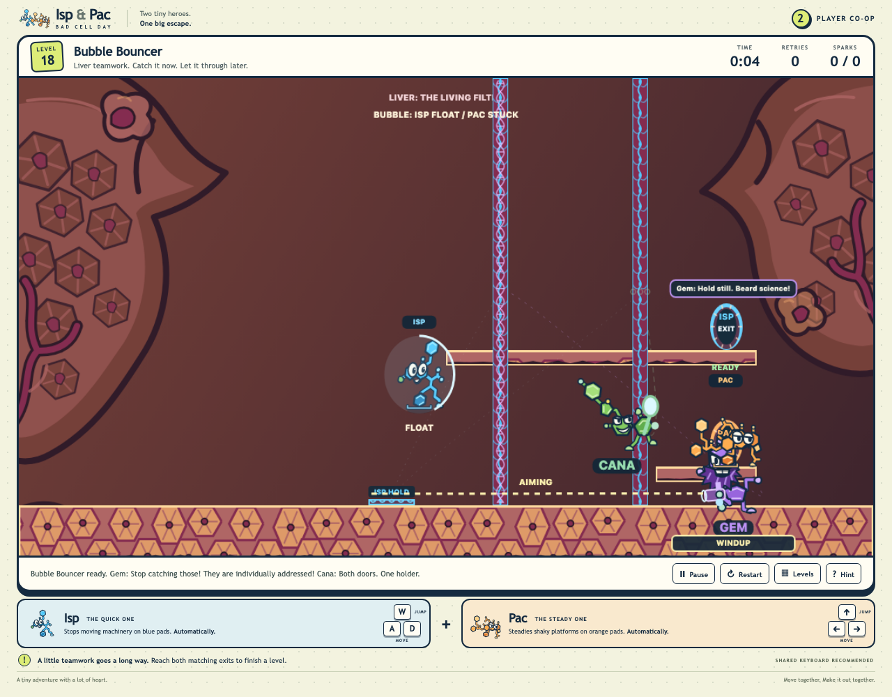

# Usage

## Build and preview

With Node.js/npm and Python 3 installed, start the local preview from the repository root:

```sh
./run_web_server.sh
```

The server script installs npm dependencies when `node_modules/` is missing, then builds `dist/` and serves that output on a local port. Stop it
with Ctrl+C. `build_github_pages.sh` creates the static `dist/` artifact for GitHub
Pages. Building and serving locally do not publish or deploy the site.

## Difficulty assessment records

The accepted current57 expert report, map, and [concise findings](difficulty_runs/current_57/FINDINGS.md)
are available from the [run ledger](difficulty_runs/current_57/README.md) and
[acceptance report](active_plans/reports/difficulty_57_acceptance.md). The map reports expert design
estimates, not human-play measurements. Current53 remains historical and does not score the revised
current campaign. The bounded `level_19` Cana finish milestone was accepted as
`DONE_WITH_CONCERNS` on 2026-10-19; this revision is not rated in current57. The frozen report and
records have not been regenerated or changed. See the [Cana finish ledger](active_plans/active/CANA_FINISH_PROTOTYPE.md)
for the delivery evidence and scope.

## Current campaign evidence

The [fresh current57 browser journey](active_plans/reports/CURRENT57_DELIVERY.md) completed all 57
rooms from an empty save, confirmed the patient-rescued finale, and verified saved progress after
reload. It uses ordinary keyboard input along prepared routes; human fun, discovery, and keyboard
comfort remain unknown.

## Development checks

Run the repository checks and production build with:

```sh
./check_codebase.sh
./build_github_pages.sh
```

Run the Playwright browser tests against a fresh build with:

```sh
./run_playwright_tests.sh --build
```

## Controls

The game uses a local keyboard for both players. Isp moves with A and D and jumps
with W; Pac moves with the arrow keys and jumps with Up. Both players can press R
to restart or Escape to pause. Pads activate their listed effect when occupied by
the assigned character; STEADY stabilizes its platform while held.

Blue and orange barriers filter characters by their assigned color; purple barriers
block both. A rescue switch latches so the partner can follow. Heavy objects require
the characters to push together and can be stacked. Completing levels unlocks later
rooms in campaign order; progress is saved in the browser's local storage by stable room ID.
Earned rooms remain replayable, while added rooms now come before later unearned
rooms in the campaign. Cargo Exchange adds linked lifts that move only while both heroes ride;
their relative cargo load chooses direction, and parking the first crate at CARGO PARKED releases
the return crate. Its central status panel labels cargo-pad weight separately from HUD sparks and
confirms when parking releases the return sac; that confirmation stays visible as the heroes move.
Approach a sac from either side and use the movement keys to push. GRIP marks side reach; standing
on top shows PUSH SIDES. Matching gate tags show OPEN or LOCKED.
The desktop game is designed for keyboard play.

Gem and Cana are physical opponents in scenes that contain them. Jump over either villain or shove
them aside with ordinary movement; their authored weapons remain active during contact. An acid
dunk removes a villain for four seconds, after which the attacker returns and resumes its attack.
In **Bridge Over Troubled Slime**, either villain can be pushed into its acid while the usual
cooperative route remains available without a dunk. Cana's far-bank boomerang stays active; Pac's
STEADY pad controls the bridge and RESCUE stabilizes it, while neither pad interrupts the weapon.
In **Stop Right There!**, lower lung folds let either hero recover a missed ferry transfer and
continue the crossing; Isp controls the ferry with STOP, and Pac reaches RESCUE to open Isp's route.
See the [physical-villains plan](active_plans/active/physical_villains.md) for current implementation
and acceptance status, and the
[level 3 acid-push report](active_plans/reports/level3_acid_push_acceptance.md) for that room's
evidence.

Sound effects start off. Use **Sound on/off** in the game controls to change the saved preference.
If sound is enabled, the first click or accepted keyboard action unlocks playback; no cues play
until gameplay changes state. A browser that blocks audio still allows the game to continue. Visual
cues remain available when sound is off.

## Anatomical chapters

The body map shows which organs and sites are cleared and names the next uncleared site. Find it in
**Levels** or between levels.

The current registered source roster has 58 rooms: lungs 1-6, intestine 7-17, marrow 18-27, liver
28-41, brain 42-57, and the tumor finale at campaign position 58 (stable `level_20`). **Breathing
Room** (`level_57`) is lung position 6 / campaign position 6, after **Hold Your Breath** (`level_37`)
and before **Gut Feeling** (`level_45`). Pac rides the travelling lower fold while Isp pushes the
nutrient sac down as a step; at the far tissue, Isp launches Pac to the high exit and takes the low
exit. At the original 57-room promotion checkpoint, the first 56 level definitions and their relative
order were unchanged. The registered native
clear took 1,071 frames / 8.925 seconds; the simultaneous-jump miss rejoined at frame 101. The focused
built-browser flow seeded only five prior completion records, saved 6/57, advanced to Gut Feeling at
display 07, and after reload showed Breathing Room as Replay and Gut Feeling as Ready. Five captured
views had no deaths or browser errors. Root accepted the bounded milestone as `DONE_WITH_CONCERNS` at
2026-10-18 18:42:16 UTC after the 96-check gate, build, two browser smokes, and fresh SPEC, QUALITY,
and integration reviews; see the [delivery evidence](../tests/_temp/breathing_room_delivery/PHASE_B_REPORT.md)
and [integration report](../tests/_temp/breathing_room_integration/REPORT.md). This is not a fresh
57-room journey or human playability/fun assessment. Recovery is not universal: a preserved delayed
attempt pushed the sac off its dock. At that 2026-10-18 18:42 checkpoint, levels 54-57 were
unassessed; the historical current53 difficulty assessment remained frozen, with no rescore. No
milestone work remains; the broad game goal remains active.

**The Liver-y Service** (`level_58`) is liver position 12 / campaign position 39, after **Two for
One** (`level_28`) and before **Special Delivery for Gem** (`level_15`). Pac pushes the light sac
below while Isp can draw Cana's boomerang across the upper folds; WEIGH 3 needs the sac and both
heroes. See the [delivery ledger](active_plans/active/LIVERY_SERVICE.md). This room has not been
difficulty-assessed or tested with human players.

In the final tumor room, Isp holds the upper TARGET to keep Pac's bridge steady. Pac jumps over
Cana's outbound boomerang, then uses its rightward return shove to jump to the far ledge. A missed
landing can return through the lower fold. Keep both TARGET pads occupied for two seconds to finish.
The current level20 revision passed its registered native clear and miss/rejoin, five built-browser
views, and seeded 57/57 save and Replay flow; root accepted it as `DONE_WITH_CONCERNS` on 2026-10-18.
This focused evidence is not a fresh campaign or human-play assessment, and the revised room remains
unassessed for difficulty.

In **Bombs Need Personal Space** (`level_14`), Pac holds OPEN / PAUSE while Isp boards the moving
refuge, then releases it to cross Gem's bomb gap. Pac can board and follow; Isp's RESCUE latch opens
Pac's far exit. A lower lip catches a missed landing and lets Pac reboard. The registered scripted
clear, miss/reboard route, five built-browser views, and bounded save/Next/reload flow pass. Root
accepted the revision as `DONE_WITH_CONCERNS` at 2026-10-18 19:15:58 UTC after SPEC, QUALITY,
integration, and review of all five original captures. The seeded flow is not a fresh 57-room journey;
level 14 and levels 54-57 remain unassessed, the frozen current53 difficulty map was not rescored, and
human discovery/enjoyment remain unknown. No milestone work remains; the broader gameplay goal remains
active. See the [delivery plan](active_plans/active/liver_refuge_delivery.md).

### Earlier campaign checkpoints

The following positions and counts describe their dated builds before Breathing Room was inserted.

**The Weight of Cana** (`level_55`) is marrow position 5 / campaign position 21, after **Elevator Etiquette**
(`level_10`) and before **Cargo Exchange** (`level_23`). Pac and Isp balance paired lifts with Cana
and Gem; Cana's boomerang shifts the load before the heroes take separate exits. Ordinary, early-hop,
and full-fall/retry native cases replay against registered `level_55`. Root
accepted the public build, browser, and focused progression evidence with concerns at 2026-10-18
16:05:16 UTC; see the [public-play report](../tests/_temp/weight_of_cana_public_play/conciseREPORT.md)
and [final integration](../tests/_temp/weight_cana_final_integration/REPORT.md). Human discovery and
enjoyment remain unknown. It remains unassessed alongside `level_54`. The frozen current53 difficulty
assessment and historical 53-room journey remain unchanged.

**A Heavy Thought** (`level_56`) is brain position 6 / campaign position 45, after **Passing
Thoughts** (`level_52`) and before **Attention, Please!** (`level_27`). Isp holds POWER on the high
perch while Pac rides the heavy sac; Pac jumps back onto the ferry deck to hold BRAKE, then Isp takes
the high route to rejoin Pac. They push the sac together onto DELIVER. The registered ordinary route
clears in 2,505 frames (20.88 seconds); the limited missed-transfer recovery ends at 742 frames with
Pac safely back on the ferry and BRAKE active. It does not establish cargo-loss recovery or a second
full clear. Root accepted fresh SPEC and QUALITY reviews with concerns for integration and reviewed
seven final screenshot views: six from this room and an opening-room readability check. The ordinary
clear records zero deaths and no browser errors. A focused save/progression flow starts from 44 prior
completions, saves 45/56, advances to Attention, Please! at display 46, and after reload shows A Heavy
Thought as Replay and Attention, Please! as Ready. All seven views passed without errors; the organ
heading and hero-card control descriptions are readable. The focused run is not a fresh 56-room
journey, and the historical current53 assessment and 53-room journey remain unchanged. No difficulty
rescore or human discovery/fun assessment was made; levels 54-56 remain unassessed. Root accepted the
bounded milestone as `DONE_WITH_CONCERNS` at 2026-10-18 17:57:51 UTC. No work remains for this
milestone; the broad game goal remains active. See the [public-play report](../tests/_temp/heavy_thought_public_play/final_report.md),
[SPEC re-review](../tests/_temp/heavy_thought_respec/REPORT.md),
[QUALITY re-review](../tests/_temp/heavy_thought_requality/REPORT.md), and
[final integration report](../tests/_temp/heavy_thought_integration/REPORT.md).

**Cana-stipation**
(`level_53`) is at intestine position 5 / campaign position 10, after **Gut Instinct** (`level_34`)
and before **Cana's Moving Target** (`level_54`). **Cana's Moving Target** is intestine position 6 /
campaign position 11, between **Cana-stipation** and **The Great Cell Shuffle** (`level_05`). Pac
braces the powered moving fold while Isp crosses above; Cana's boomerang shoves Pac aside, and the
carrier catches Pac again if Pac stays on the fixed fold. Pac then takes the lower route. A separate
scripted route demonstrates Isp's initial missed-ferry recovery. At its acceptance checkpoint, the
room had focused browser and progression evidence, but no fresh 54-room journey, difficulty
assessment, or human playability finding.

The following records are historical. The 53-room journey and current53 difficulty assessment
predate this addition. **Cana-stipation**'s route centers on Cana jamming the powered carrier beneath
a low tunnel: Pac clears the carrier while Isp powers it, then Pac latches a lift for Isp's high
exit. Source/build, served-identity, public-capture, SPEC, and six audit gates passed. The fresh
53-room journey passed with zero retries/errors and reload checkpoints at 10, 20, 30, 40, 50, and 53. Root accepted this bounded milestone as `DONE_WITH_CONCERNS` at 2026-10-18 11:33:03 UTC; human
discovery and enjoyment remain unmeasured. Brain room **Passing Thoughts** (`level_52`) is
at brain position 5 / campaign position 42, after **Crossed Paths** (`level_22`) and before
**Attention, Please!** (`level_27`). Its authored route
has Pac board Isp's moving fold, use Isp's head to reach the high path, and power Isp's lift.
**A Bone to Pick**
(`level_51`) is at marrow position 6 / campaign position 21, after **Cargo Exchange** (`level_23`)
and before **Marrow Cargo Shuffle** (`level_12`). **Bone Voyage**
(`level_49`) is at marrow position 2 / campaign position 17, after **Split Decision** (`level_11`)
and before **Two Tons of Trouble** (`level_09`); its addition preserved the previous 48 rooms'
relative order. **Gut Reaction**
(`level_48`) is at intestine position 7 / campaign position 12, after **The Great Cell Shuffle**
(`level_05`) and before **Double Trouble** (`level_07`), preserving the order of all earlier rooms.
**Dead Weight** (`level_46`) is at liver position 8 / campaign position 32, after
`level_32` and before `level_14`. **Gut Feeling** (`level_45`) is at intestine position 1, after
**Hold Your Breath** (`level_37`) and before `level_06`; Gut Feeling's addition preserved the prior
44-room order. **Hold Your Breath** (`level_37`) is at lung position 5, completing that chapter;
**Boneheads** (`level_39`) is at brain position 7 / campaign position 44, after `level_27` and
before `level_35`; **Neural Misfire** (`level_42`) is at brain position 10 / campaign position 47,
after `level_31` and before `level_38`; **Jump to Conclusions** (`level_38`) is at brain position 11 /
campaign position 48, before `level_50`; and **Bursting Point** (`level_40`) is at liver position 2 /
campaign position 25, after `level_13` and before `level_24`. **Cana's Friendly Fire** (`level_41`)
is at intestine position 10 / campaign position 15, after `level_47` and before `level_11`. Dead
Weight's addition preserved the previous 45 rooms' relative order. **Backseat Driver** (`level_50`)
follows at brain position 12 / campaign position 49, before `level_29`, `level_33`, and `level_19`
at positions 50-52. The tumor finale is position 53.
**Step On It** (`level_44`) appears at liver position 5 /
campaign position 29, after `level_30` and before **Cellpool Lane** (`level_43`) at liver position 6 /
campaign position 30. **Bring Your Own Villain** (`level_32`) follows at liver position 7 / campaign
position 31, before Dead Weight. The completed
scripted current41 native and empty-save browser journeys apply to a frozen earlier roster. The
current44 difficulty assessment is also an immutable earlier-order snapshot; it does not assess
Gut Feeling, Dead Weight, Backseat Driver, Passing Thoughts, or the live 52-room order. The earlier
51-room journey predates Passing Thoughts and does not cover the current roster. See the [Dead Weight production status](active_plans/reports/DEAD_WEIGHT_ACCEPTANCE.md),
[Gut Feeling acceptance record](active_plans/reports/GUT_FEELING_ACCEPTANCE.md), and [production ledger](active_plans/active/EARLY_MOVEMENT_RELAY.md).
They establish operability for that snapshot, not human discovery, enjoyment, or coordination. The
source-bound current41 expert assessment is complete and root accepted it as
`DONE_WITH_CONCERNS`. Its ordinal estimates are not measured human difficulty; all 41 first-pass
platforming values remain unknown, and zero control-friction estimates do not establish physical
keyboard comfort. See the [run ledger](difficulty_runs/current_41/README.md),
[findings](difficulty_runs/current_41/FINDINGS.md), [campaign map](difficulty_runs/current_41/campaign_map.json),
[generated report](difficulty_runs/current_41/report/LEVEL_DIFFICULTY_REPORT.md), and
[acceptance receipt](active_plans/reports/difficulty_41_acceptance.md). Current38 remains frozen
historical evidence; its scores are not inherited. The reported Level 3 bridge motion/fall risk remains
unresolved. See [LEVEL_DIFFICULTY.md](LEVEL_DIFFICULTY.md). Boneheads passed native checks, source
checks, build, standard smokes, and browser progression; root accepted it with concerns, including a
nonblocking Cana status-tag overlap on the bottom exit rim. Its [plan](active_plans/active/BONEHEADS_ROOM.md)
records that room's evidence and limits. Root accepts `level_38` as DONE_WITH_CONCERNS; its
[plan](active_plans/active/split_launch_room.md) and
[acceptance receipt](active_plans/reports/split_launch_acceptance.md) record its evidence and limits. The
accepted current38 paired assessment remains frozen to its 38-room source/order snapshot and does
not assess the current52 roster. The separate accepted current41 assessment covers stable
`level_39`, `level_40`, and `level_41`; see its [acceptance receipt](active_plans/reports/difficulty_41_acceptance.md)
and the [assessment links and limits](LEVEL_DIFFICULTY.md).

In liver room **Step On It** (`level_44`), Isp nudges Gem off the left ledge so Pac can jump from
Gem onto START BUBBLES. Pac starts Gem's recurring bubbles; Isp catches FLOAT, lands on the high
roost, and waits while Pac takes the floor exit. The room reuses the existing controls and liver art.
Root accepted this bounded production milestone as `DONE_WITH_CONCERNS`; human discovery, fairness,
enjoyment, difficulty, and paired comfort remain unmeasured. See the [acceptance report](active_plans/reports/step_on_it_acceptance.md)
and [production plan](active_plans/active/villain_step_return.md).

In liver room **Cellpool Lane** (`level_43`), Isp rides Pac, then jumps with Cana's right-going throw
to the high route. Each hero latches the other exit; the return fold lets them regroup and try again.
The room reuses the existing controls and liver art. Root accepted this production milestone as
`DONE_WITH_CONCERNS` after native and browser routes, code/build checks, standard smokes, and reviews
passed. Human readability, discovery, fun, and difficulty remain unmeasured; current41 remains frozen
and does not assess this room. See the [acceptance receipt](active_plans/reports/CELLPOOL_LANE_ACCEPTANCE.md)
and [room plan](active_plans/active/CELLPOOL_LANE_ROOM.md).

In brain room **Neural Misfire** (`level_42`), Pac baits Cana's boomerang, which can shove Gem into
bubble range. Isp FLOATs to the upper landing and activates OPEN PAC for Pac's lower exit. The room
reuses the organic brain art and existing controls; active weapons keep moving after a bait latches.
Implementation and native public-engine replay are complete. The built-browser clear, delayed
first-bubble miss followed by later FLOAT recovery, and source, distribution, and served identity
are verified; root reviewed the original captures. Fresh integration review accepts with concerns,
and root accepts this bounded room milestone as `DONE_WITH_CONCERNS`. Next/save/reload/42-row-menu
checks were not run and are not required gates.
Human discovery, readability, enjoyment, and difficulty remain unmeasured. See the
[acceptance receipt](active_plans/reports/NEURAL_MISFIRE_ACCEPTANCE.md).

**Bursting Point** (`level_40`) is the liver room at display position 21. Pac loads the fragile roof
to open Isp's upper route; Isp uses Gem's recurring FLOAT while Pac takes the lower exit. An early
FLOAT can be blocked by the intact roof, then recovered after the roof opens and Gem fires again.
Native and built-browser routes reach the separate exits with zero deaths; the room's original browser
receipt also confirms save, Next to `level_24`, reload/replay, all 39 prior stable IDs, and finale last.
Production SPEC accepts, all six QUALITY passes are complete, integration accepts with concerns,
and root accepts the milestone `DONE_WITH_CONCERNS`. The old 39-room full journey is historical proof
for its earlier roster, not a full current41 journey. Human discovery, comfort, enjoyment, readability,
and difficulty remain unmeasured. See the
[Bursting Point plan](active_plans/active/BURSTING_POINT_ROOM.md).

The historical current39 native replays showed ordinary-input routes to both exits in all 39 rooms.
The accepted empty-save browser journey also completed those 39 in order, saved each completion, and
retained normal progress after reloads at positions 10, 20, 30, and 39. Fresh SPEC, distinct QUALITY,
and integration accept with concerns; root accepts this bounded earlier-roster evidence as
`DONE_WITH_CONCERNS`. Scripted operability does not measure human discovery or enjoyment. See
[active_plans/active/CURRENT39_PLAYABILITY.md](active_plans/active/CURRENT39_PLAYABILITY.md) for the
evidence and limits.

The accepted `level_37` implementation and evidence remain in the
[lung recoil acceptance receipt](active_plans/reports/LUNG_RECOIL_ACCEPTANCE.md). Human discovery,
enjoyment, and shared-keyboard comfort remain unmeasured.
In **Gut Reaction** (`level_48`), Isp can take an optional first tissue bounce to reach the high
Spark while Pac rides the low moving fold. They meet at the far tissue: Isp bounces Pac to the high
exit, then takes the low exit. Gem's bubbles and Cana's boomerang remain active.
Intestine room `level_34`, **Gut Instinct**, follows `level_08` and precedes `level_05`.
One movable ordinary sac chooses Upper or Lower Flow; Isp owns the upper route and Pac the lower.
Either hero can operate the sac, and either owner latch can be first. Each latch secures its route
and frees the partner's exit. Gem's recurring upper-route bubble can give Isp FLOAT; an existing
one-time latch interrupt cancels the shot, after which the attack resumes. The accepted
DONE_WITH_CONCERNS milestone passed both browser latch orders, the Pac-first Isp-operated cargo
route, gate recovery, and focused seeded unlock/save/ending checks. Human enjoyment, novice
suitability, two-person comfort, and the unseeded 35-room journey at that checkpoint were unmeasured. See the
[Gut Instinct acceptance report](active_plans/reports/two_lane_fork_acceptance.md).

Brain room `level_35`, **Pick On Someone Else**, follows `level_39` and precedes `level_31`. Its
approved physical-villain adaptation uses two separate parcels. Pac holds OPEN LEFT from the right
while Isp moves aside for Cana's left-side shot, then Isp keeps LEFT with the left parcel parked on
its pad. Isp holds OPEN RIGHT from the far left while Pac moves aside for the other shot, then Pac
keeps RIGHT with the right parcel on its pad. Each parked parcel holds its own pad without a hero standing on it. The production two-parcel source
and hint are applied. Its ordinary route clears in 756 frames with zero deaths; the focused
current-bundle browser route also clears. See the
[physical-villains plan](active_plans/active/physical_villains.md) for evidence and review status.

Liver room
`level_30`, **Your Turn to
Carry**, follows `level_24` and precedes `level_32`. The heroes carry one another horizontally while
standing on each other to cross their character-specific fluids, then swap roles on a dry island.
Its locally accepted delivery passed focused normal/reduced browser checks, both smokes, and the
30-room journey with finale and save/reload. The frozen 31-room assessment includes an expert
estimate for this room, but no human-play result. See
[active_plans/reports/cooperation_surprise_acceptance.md](active_plans/reports/cooperation_surprise_acceptance.md).

Liver room `level_32`, **Bring Your Own Villain**, follows `level_30` and precedes
`level_14`. Pac powers and rides the moving carrier to bring Gem's muzzle within bubble range; Isp
can catch FLOAT, steer to the upper route, and latch Pac's lower door. A safe floor and recurring
bubbles allow a missed approach to be retried. The unseeded 32-room campaign and save journey passed
on the R2 gameplay build; focused normal/reduced-motion browser routes and the final reviews passed
on R3, which only moves inactive Cana's display position. Root accepts the local milestone as
DONE_WITH_CONCERNS. Difficulty assessment, human discovery, enjoyment, novice suitability, and
paired-control comfort remain unknown. See the
[moving Gem acceptance ledger](active_plans/reports/moving_gem_acceptance.md).

Brain room `level_31`, **Knock It Off**, follows `level_35` and precedes `level_38`.
Cana's boomerang nudges lightweight crates on both outbound and return legs by its actual horizontal
travel; heavy crates and bubbles keep their behavior. The hint suggests drawing a committed shot
through the hero-inaccessible duct, pushing the sac off the ferry while it is low, then recovering
it from the gutter if needed. A hero and the sac can power the bridge while a partner rides. Native
registered routes include a full completion and recovery after a wrong first target. Solo cargo work
remains possible, and the heroes can exchange cargo and riding roles. The ferry can catch the sac
passively. This local milestone is accepted as DONE_WITH_CONCERNS. The frozen 31-room assessment
includes an expert estimate for this room, but no human-play result.
See the
[living decisions ledger](active_plans/reports/living_decisions_acceptance.md) for current evidence
and review status.

Background organ drawings are static; foreground tissue and mechanisms show existing puzzle state
while keeping safe edges, hazards, characters, and controls clear. Reduced motion keeps decorative
movement still while game mechanisms continue to respond. The art uses playful anatomical forms as
the setting for puzzles, not as a clinical lesson.

[README.md](difficulty_runs/current_36/README.md) includes the
[campaign_map.json](difficulty_runs/current_36/campaign_map.json),
[LEVEL_DIFFICULTY_REPORT.md](difficulty_runs/current_36/report/LEVEL_DIFFICULTY_REPORT.md),
[difficulty_campaign.svg](difficulty_runs/current_36/report/difficulty_campaign.svg), and
[FINDINGS.md](difficulty_runs/current_36/FINDINGS.md). Full validation and report
consistency checks passed; fresh SPEC, recovery SPEC, QUALITY, and integration reviews
ACCEPT_WITH_CONCERNS. Root accepts the assessment as DONE_WITH_CONCERNS. The earlier accepted
32-room assessment is preserved as
[historical evidence](difficulty_runs/current_32/README.md), not the current roster profile. Current36
values are weighted summaries of ordinal expert judgments, not calibrated measurements. Human
success, discovery, enjoyment, frustration, completion time, and two-person keyboard comfort remain
unknown. Use the separate
[human play observation sheet](LEVEL_DIFFICULTY.md#human-play-observations) for actual player
evidence. See the [difficulty_36_refresh.md](active_plans/active/difficulty_36_refresh.md) and
[difficulty_36_acceptance.md](active_plans/reports/difficulty_36_acceptance.md) for the source-bound inputs,
workflow, acceptance receipts, and evidence limits.

The frozen [32-room findings](difficulty_runs/current_32/FINDINGS.md) informed the approved Marrow
milestone in [recurring_marrow.md](active_plans/active/recurring_marrow.md): add one boomerang to
`level_11`, clarify the latch state label, and align `level_10`'s opening cue with its ride-first
route. The frozen assessment remains the R3 baseline, not fresh scores for changed source. The R2
auxiliary full-campaign evidence differs from R3 only by inactive Cana's display position (x80 to
x750); the R3 captures and focused browser evidence are distinct. Human fun and control comfort are
unproven. The frozen
[`current_31` run](difficulty_runs/current_31/README.md) remains historical evidence for its earlier
campaign and source.

The [23-room difficulty findings](DIFFICULTY_FINDINGS.md) are historical estimates bound to the
visual source before the organ migration. The 28-room run is a frozen pre-Gem source snapshot, and
the 29-room run is frozen against its recorded pre-art/pre-carry source and build; neither is a
current-source assessment or build gate. Keep their artifacts and scores unchanged as bounded design
input. Their navigation is in [LEVEL_DIFFICULTY.md](LEVEL_DIFFICULTY.md),
[current_28 findings](difficulty_runs/current_28/FINDINGS.md), and
[current_29 findings](difficulty_runs/current_29/FINDINGS.md). None of these expert estimate sets
measures human outcomes or paired comfort. The
[28-room acceptance ledger](active_plans/reports/current_difficulty_acceptance.md) and
[29-room acceptance ledger](active_plans/reports/difficulty_29_acceptance.md) record their distinct
status and limits; the [Gem Lair acceptance ledger](active_plans/reports/gem_lair_acceptance.md)
owns current implementation gates.

## DNA and glucose puzzles

The recurring villains are physical opponents as well as puzzle guides. Purple,
bearded Gem marks DNA walls, bridges, and traps; green, clean-shaven Cana marks
glucose-powered gates and machines. Their bodies can be jumped over or shoved while
their authored weapons stay active. These are game cues and character themes, not
clinical or complete biochemistry explanations.

The first room, "Hold That Door!", teaches the handoff without hazards: Isp holds
the switch so Pac can cross and latch RESCUE, opening the route for Isp. The second
room, "Glucose Going Up!", adds the DNA and glucose sequence plus the powered lift.
The lift's safe jumping challenge is intentional. See
[LEVEL_DIFFICULTY.md](LEVEL_DIFFICULTY.md) for the expert-assessment workflow, generated report,
and separate human observation sheet; [DIFFICULTY_FINDINGS.md](DIFFICULTY_FINDINGS.md) interprets
the historical 23-room estimates. [DIFFICULTY_RUBRIC.md](DIFFICULTY_RUBRIC.md) owns the scoring
method. On later levels, a powered platform moves only when its motor is also running. A power
outage pauses its motion while leaving it solid; an active power pad can
restore power through an outage, and motor-stop controls remain independent.

Villain reactions follow actual puzzle progress. A partial-progress reaction is
shown only after nonempty progress when every required target is complete.

**Gem's Liver Lair** (`level_16`) uses an automatic short-range bubble attack with
the existing range of 150. STEADY and RESCUE each interrupt it once, after which it recurs; normal
boss success ends the attacks. The center robot display is the existing glucose-organ SVG drawn as
a pump above Gem. Existing target and boss-defeat state provide its feedback; the room adds no Cana
attack, objective, or simulation state. See the
[Gem Lair acceptance ledger](active_plans/reports/gem_lair_acceptance.md) for current evidence and
open gates.

## Campaign interference

Gem and Cana act from the first room and recur throughout the campaign. Their solid bodies can be
jumped over or shoved aside without disabling their weapons. Gem returns four seconds after an acid
dunk, and his attack resumes. In Level 3, ordinary movement can push either villain into the acid;
the same recovery timing applies wherever a villain scene authors an acid return. Gem's bubble can
float Isp, stick Pac on a side contact, or let a descending Pac bounce from its gold top. A top
bounce marks Pac as hit once and keeps that bubble on its fixed path, so Isp can catch it later for
FLOAT; an ordinary side hit still consumes it. Cana's returning boomerang can daze Isp or shove Pac.
These effects are temporary, directional control remains available during DIZZY, and opening lanes
provide safe places to wait or recover. Watch the warning and projectile direction, then use the
room's pads, rescue latch, or a walking route to manage the pressure. Under the approved recurring
pressure contract, each bound pad interrupts an attack once per attempt, cancels its active shot,
and buys a full cooldown and fresh warning. Holding or latching that pad does not repeat the
interrupt. Start pads start their attacks once; leaving them does not stop the encounter.
Boss defeat or room completion ends the pressure. The implemented behavior and its acceptance
gates are recorded in [recurring_villain_pressure.md](archive/recurring_villain_pressure.md).

In the early intestine rooms, a near-bank missed ferry dismount can land on a small catch fold.
Jump back to the island and resume the assigned pad and rescue duties; the ferries remain part of
the route. The fold does not catch every fall: an early walk-off in `level_07` can still miss it.
See the [early recovery acceptance report](active_plans/reports/early_recovery_acceptance.md) for
the accepted implementation and evidence limits. The dedicated development capture tool can replay
optional finite input cases against the built game:

```sh
node --import tsx devel/capture_gameplay_screenshots.mjs
node --import tsx devel/capture_gameplay_screenshots.mjs cases.json
```

The optional JSON is a non-empty array of cases with a stable `levelId`, PNG basename, and input
intervals in native frames and held keys. For example:

```json
[
  {
    "levelId": "level_07",
    "file": "level07_clear.png",
    "intervals": [
      [1, []],
      [20, ["ArrowRight"]]
    ],
    "expectedPhase": "playing"
  }
]
```

Supported keys are `ArrowLeft`, `ArrowRight`, `ArrowUp`, `a`, `d`, and `w`. Optional `hero` and
`effect` fields must be supplied together. Captures and the receipt are written under
`/private/tmp`; the helper checks the served build hash, final phase, deaths, and browser errors.

The displayed opening begins with a walking room. In **Hold That Door!** (`level_02`), low tissue
folds give the heroes footing to hop over or shove Gem and Cana. The same HOLD-to-RESCUE
lesson remains: Pac sees the door close when HOLD is lost; return to HOLD to reopen it, or reach
RESCUE to interrupt both attackers once while preserving the door for Isp. The second room
(`level_01`) has Gem ride the existing two-hero lift at RESTORE and FLOAT Isp off it; Cana waits on
the upper arrival balcony. The two-hero latch stays latched. Reboard from the safe floor, or wait
at the side for the lift to return, before continuing the jumping and lift curriculum.
Later opening rooms introduce Cana at the far bank and Gem at a safe ferry shore, then revisit
those effects in `level_06`, `level_08`, `level_05`, and `level_07`. In `level_04`, Pac's STEADY
activates the bridge and Cana's far-bank shot for the attempt. RESCUE stabilizes the bridge; this
room has no weapon-interrupt pad, and Pac leaving STEADY does not turn Cana off. Countering a
villain's puzzle scheme and interrupting its weapon are separate actions.

The bridge shows a growing bruise and tears as its existing collapse progress advances; the top
landing rim stays fixed. The always-visible Level 3 subtitle reads "Pac holds STEADY until Isp
reaches RESCUE." These cues describe the existing support state and do not diagnose the reported
sideways motion or establish reduced fall risk. See the
[bridge readability report](active_plans/reports/bridge_readability_acceptance.md).

The recurring-pressure milestone has focused ordinary-input evidence for interruption, resumed
warnings/shots, useful FLOAT routes, recovery, and lifecycle behavior. Its isolated trial also
passes in normal and reduced motion with fresh and existing campaign saves. A historical fresh
normal-motion Play/Next run completed the then-current 24 rooms and finale, then reloaded all 24
Replay entries with identical save bytes. That result predates later room additions. See
[recurring_villain_pressure_acceptance.md](active_plans/reports/recurring_villain_pressure_acceptance.md)
for that historical evidence, fresh integration, and explicit manager acceptance as
DONE_WITH_CONCERNS. Scripted completion does not show that first-time players discover the
responses or enjoy the pressure. Use the human
observation sheet in [LEVEL_DIFFICULTY.md](LEVEL_DIFFICULTY.md) for actual player attempts; use
its separate two-pass workflow for expert estimates.

In **Double Trouble** (`level_07`), the selected room-local handoff has Pac hold STEADY to brake the
far ferry while Isp boards it, then release STEADY so the moving ferry carries Isp toward RESCUE.
The far ferry then supports Isp's jump to the far shore. See the
[campaign momentum ledger](active_plans/reports/campaign_momentum_acceptance.md) for its evidence
and acceptance status.

Several rooms make interference part of the cooperative route:

| Room / stable ID                       | Partner handoff                                                                                                                                                                                                                                                                                                                                                                                                                                                                                                                                                            |
| -------------------------------------- | -------------------------------------------------------------------------------------------------------------------------------------------------------------------------------------------------------------------------------------------------------------------------------------------------------------------------------------------------------------------------------------------------------------------------------------------------------------------------------------------------------------------------------------------------------------------------- |
| `level_34`, Gut Instinct               | One movable sac chooses Upper or Lower Flow. Isp owns the upper route; Pac owns the lower. Either hero can move the sac, and either owner latch can be first. Each latch secures its route and frees the partner's exit. Gem's recurring upper-route bubble can give Isp FLOAT; the existing latch interrupt cancels one shot before the attack resumes.                                                                                                                                                                                                                   |
| `level_36`, A Little Push              | Isp holds SAFE LANDING to protect Pac's lower-route landing; Pac times an ordinary jump with Cana's right-going SHOVE. OPEN ISP latches the support and frees Isp for the sealed upper route; a missed jump returns through the lower fold.                                                                                                                                                                                                                                                                                                                                |
| `level_13`, Gem's Bubble Break         | Pac holds BUBBLES to start Gem once. Isp waits to Gem's right, floats upward, and steers right to RESCUE. The latch interrupts Gem once and opens Pac's route to the right stairs and matching exits. A continuous floor and recurring bubbles support retries of the float without death.                                                                                                                                                                                                                                                                                 |
| `level_24`, I've Got You               | Isp holds LIFT to start Gem once while Pac jumps onto him. Gem's FLOAT carries Pac to the upper CROSS hold, opening Isp's lower route. Isp latches RECONNECT to preserve that gate and open Pac's onward route. The safe floor and repeatable ride permit recovery after a fall.                                                                                                                                                                                                                                                                                           |
| `level_30`, Your Turn to Carry         | Isp and Pac use collision-clipped horizontal carrying in both directions to cross low fluids that harm the named hero. They swap carrier/rider roles on the dry island; exits sit on separate dry shores. The accepted 30-room milestone passed focused normal/reduced browser checks, both smokes, and campaign/save review. One public room29 retry used Restart; later native evidence traces the helper miss without finding a product defect. See [active_plans/reports/cooperation_surprise_acceptance.md](active_plans/reports/cooperation_surprise_acceptance.md). |
| `level_32`, Bring Your Own Villain     | Pac powers and rides the moving carrier so Gem's muzzle can reach Isp with FLOAT. Isp steers to the upper route and latches Pac's lower door; recurring bubbles support a missed-approach retry. The R2 full-campaign/save journey and R3 normal/reduced browser routes pass; human discovery, enjoyment, and paired-control comfort remain unmeasured.                                                                                                                                                                                                                    |
| `level_26`, Bubble Bouncer             | Isp holds HOLD to open both doors. Pac crosses the gates and jumps onto the shelf before its far end. Pac can intercept a bubble while clearing the lane; when the route is clear, Gem's bubble gives Isp FLOAT to reach the upper path.                                                                                                                                                                                                                                                                                                                                   |
| `level_28`, Two for One                | Isp carries Pac on his head, then Pac jumps onto Gem's moving bubble and rebounds from its gold top. The same bubble continues along its fixed path so Isp can catch it for FLOAT; a later bubble remains a valid recovery. Their separate ledges do not require same-flight completion.                                                                                                                                                                                                                                                                                   |
| `level_18`, A Meeting of Minds         | Pac holds PARK to stop the shelf, open the upper DNA gate, and stabilize the lower bridge. Release PARK to send Isp onward; rehold to position the shelf or recover through the lower bridge. Isp latches RESCUE to open Pac's stairs.                                                                                                                                                                                                                                                                                                                                     |
| `level_17`, Cana's Upside-Down Commute | Pac holds OPEN to start Gem once. Isp waits on the stopped lift and uses Gem's float to reach RESCUE. The latch interrupts Gem once and powers the lift for Pac; both continue to the high exits.                                                                                                                                                                                                                                                                                                                                                                          |
| `level_25`, Return to Sender           | Isp drops a signal sac to Pac. Pac and the sac hold RECEIVE to open Isp's upper route. Isp latches RELEASE; Pac loads the return lift and uses SEND. Stepping off SEND parks the carrier for Isp to board and push the same sac onto DOCK.                                                                                                                                                                                                                                                                                                                                 |
| `level_22`, Crossed Paths              | Isp holds INVITE while Pac reaches LIFT. Isp rides up and presses HANDOFF, then waits at Gem's wall. Pac crosses Cana's returning boomerang to TURNAROUND, opening Isp's stairs; Pac then doubles back to reunite at the high exits.                                                                                                                                                                                                                                                                                                                                       |
| `level_27`, Attention, Please!         | Pac uses Isp to reach the cargo shelf and drops the signal sac; Isp pushes it against the fold to climb while Pac's natural movement draws Cana's attention. When the yellow warning commits to the nearest hero, move left along the upper perch and watch the return. The heroes take separate high and low exits.                                                                                                                                                                                                                                                       |
| `level_35`, Pick On Someone Else       | With two separate parcels, Pac holds OPEN LEFT from the right while Isp baits Cana's left-side shot, then Isp keeps LEFT after its parcel parks. Isp holds OPEN RIGHT from the far left while Pac baits the other shot, then Pac keeps RIGHT after that parcel parks. Both parcels hold their own pads with actor occupancy empty. The production route clears in 756 frames with zero deaths; current-bundle browser evidence also clears.                                                                                                                                |
| `level_31`, Knock It Off               | Pac can bait Cana's committed line through a duct and nudge a lightweight sac to the ferry and gutter. A hero and sac power the bridge while a partner rides. Solo cargo work and passive catch remain possible.                                                                                                                                                                                                                                                                                                                                                           |
| `level_29`, Changing Places            | Pac and the sac on lift A outweigh Isp on lift B; both heroes ride to the shared stop, cross, move the sac to B, and reboard to reverse. Cana's committed boomerang makes departure a dodge-or-risk choice.                                                                                                                                                                                                                                                                                                                                                                |
| `level_50`, Backseat Driver            | Pac carries Isp through Cana's right-going SHOVE; Pac jumps for the lower fold and Isp jumps off high for the upper fold. The lower return step supports regrouping after a short launch. The [production evaluation](active_plans/active/BACKSEAT_DRIVER.md) records bounded acceptance with concerns; a seeded room entry does not establish the unseeded full-campaign journey or human outcomes.                                                                                                                                                                       |
| `level_33`, No Takebacks               | Isp and Pac hold separate upstream and receiver controls while Cana's returning boomerang moves a sac through the constricted channel. Pac steps off after the sac passes to close the receiver gate; the return pushes it onto the receiver, opening separate exits.                                                                                                                                                                                                                                                                                                      |
| `level_19`, Cana's Control Freak-Out   | Isp holds STOP while Pac crosses to STEADY. Pac holds STEADY while Isp reaches RESCUE; then Isp holds blue TARGET to steady the high bridge as Pac crosses the far finish. Cana guards that finish, so Pac jumps over or pushes past his body while he keeps throwing. Both heroes hold TARGET to complete the level.                                                                                                                                                                                                                                                                 |

A Little Push combines distinct sealed upper Isp and lower Pac routes. Isp holds SAFE LANDING to
protect Pac's far landing, while Pac times Cana's actual right-going SHOVE with an ordinary jump.
OPEN ISP latches the support and frees Isp for the upper route; a missed jump returns through the
lower fold for another attempt. The landing margin is tight; human play has not been assessed.

In **Cana's Control Freak-Out**, the upper display is an anatomical brain signal knot with target and
defeat feedback. The canonical Cana actor and his returning boomerang remain separate and visible.
The room keeps its authored fixed aim: a bounded comparison found nearest-hero aim misses Pac's
natural crossing, removing the original SHOVE/interrupt moment, while its optional bait-and-dodge
route needs a deliberate RESCUE delay and adds time without a demonstrated stronger choice. The
[Cana encounter ledger](active_plans/reports/cana_encounter_acceptance.md) owns current validation
and acceptance status.

**Changing Places** (`level_29`) adds one-sac counterweight role swapping. Both lifts
move while both heroes ride; the cargo load determines direction. At their shared endpoint, Isp takes
the upper crossing and Pac moves the sac across the lower bridge. A local left shelf supports recovery
if the sac is pushed against the left end. Cana's existing nearest-target boomerang commits to the
nearest hero at warning time; watch the yellow aimline and move before impact. The [Changing Places
acceptance ledger](active_plans/reports/changing_places_acceptance.md) records accepted build,
browser, campaign, save-compatibility, and review evidence plus the remaining human-play limits.

**Attention, Please!** (`level_27`) is an earlier room that uses nearest-hero boomerang aiming.
Cana snapshots the nearest hero when the yellow warning begins and keeps that aim fixed through the
throw and return. **Changing Places** (`level_29`) and **Pick On Someone Else** (`level_35`) also use
that rule; other rooms retain their authored static aim. The global Pac bubble rebound is a separate
bubble contact rule. The Attention addition
preserved the previous 26 stable IDs and their relative order, and did not change save schema v1.

**Two for One** (`level_28`) combines an ordinary head jump, Pac's top rebound, and
Isp's later FLOAT from the same bubble before the heroes take separate exits. The gold cap marks
the bounce surface; side contact remains STICKY. Pac can miss and regroup for another shot. The
shared-flight route is an opportunity, not a completion requirement.

Three relay rooms add more partner-controlled route changes. In **Across the Divide**
(`level_21`), Isp opens ROUTE and Pac holds LIFT while Isp rides up to press LINK and
free Pac; Pac then opens Isp's return route. In **Crossed Paths**, each character opens the other's route in turn while crossing
Gem's bubble wall and Cana's returning boomerang. The earlier room definitions retain their
relative order. **Cargo Exchange** (`level_23`) follows Elevator Etiquette and
precedes Microtubule Shuffle. Pac delivers the first crate and rides down; Isp delivers the
return crate while Pac rides back. Both heroes must stay aboard for either lift to move, and
each arrival opens the partner's next route.

**I've Got You** follows Gem's useful-float introduction and adds physical passenger transport
without changing controls. Its room and villain scene are authored in
[src/level_float_passenger.ts](../src/level_float_passenger.ts). That room's addition preserved all
older 23 definitions and their relative order. The later recurring-pressure field migration
preserves geometry and order; the new stable ID does not renumber saved progress.

**Return to Sender** (`level_25`) uses one ordinary signal
sac for a down-and-back handoff. Pac and the sac release Isp's upper door; Isp's latch opens Pac's
lower delivery route. Pac powers the return lift from SEND, and Cana's shove can unexpectedly
pause it. Step off SEND to park the carrier or hop back on after a shove; Isp unloads the same sac
onto DOCK so both heroes can exit. Try alternate cooperative routes when both heroes and the shared
sac still contribute.

**Bubble Bouncer** (`level_26`) adds a liver-room bubble handoff. Isp holds HOLD to
keep both gates open while Pac moves right and jumps onto the shelf before its far end. Pac can
intercept a bubble while clearing the lane; once Pac is safely above the beam, a later bubble can
give Isp FLOAT for the upper route. The authored bubble endpoint now reaches Isp at the left edge
of HOLD; source simulation confirms that edge route. Built-browser focused cases and the fresh
26-room journey pass; the journey earns all 26 Replay entries and reloads identical progress.
Scripted completion verifies the route and save behavior, but does not establish human discovery or
enjoyment. See the [Bubble Bouncer acceptance ledger](active_plans/reports/bubble_guard_acceptance.md).



In the final room, **A Very Bad Day for the Tumor** (`level_20`), Isp reaches the high blue TARGET
to take over the bridge while Gem stands in that upper approach and sends bubbles left across it.
Pac crosses the lower route to orange TARGET, where Cana's boomerang remains a threat. Both heroes
hold their targets together for two seconds. Blue TARGET interrupts Gem once, and STEADY interrupts
Cana once; STOP controls the motor and gate, while RESCUE opens the route. Blue TARGET also
supports the bridge handoff. If a bubble breaks the joint charge, Isp can wait on the crown and
retake blue TARGET while Pac holds orange TARGET; both then hold again to finish.

WINDUP/AIMING and the dashed aimline warn before a shot. A boomerang can hit on its return;
watch its travel and keep directional control during the short effect. Cana's room
retains lethal gaps: a missed dodge or an idle shove can cost the attempt. STEADY interrupts Cana's
boomerang once per attempt, and blue TARGET interrupts Gem's bubble once; either interrupt cancels
its active shot. A hit already applied finishes its short effect. The full cooldown begins at the
interrupt; a fresh warning precedes the next shot, even while the pad remains active. Retry renews
the pad uses.

The earlier safe bubble room introduces float and steering before their later lift
application. These routes are instructions, not evidence that first-time players will
understand them without help. See [LEVEL_DIFFICULTY.md](LEVEL_DIFFICULTY.md).

## Villain interference trial

Choose **Try villain trial** from the title screen or level selector to enter the
optional Troublemaker Trial. It does not unlock campaign rooms or change saved
campaign progress. Follow the numbered route: Pac holds ENTRY while Isp rides
Gem's bubble to the raised RESCUE latch, then guide both characters to their exits.

Gem's bubble floats Isp. The global contact rule also applies in the Trial: Pac rebounds from a
descending gold-top contact with an ordinary jump, while other Pac contacts briefly make him
STICKY. Cana's boomerang briefly slows and spins Isp while keeping directional control, or gives
Pac a clipped shove. WINDUP/AIMING
and the dashed aimline telegraph each attack. Escape pauses the simulation; R retries
the room from its starting state.
