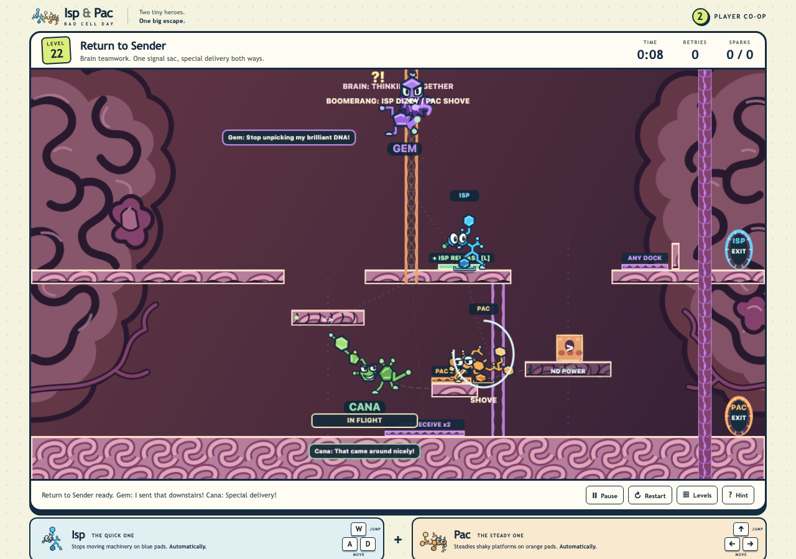

# Return to Sender acceptance

Updated 2026-10-15. This is the manager ledger for additive stable `level_25`, **Return to
Sender**, accepted DONE_WITH_CONCERNS. Source, build, browser, fresh SPEC, QUALITY, integration,
and final manager acceptance are complete. Scripted feasibility is not human play or enjoyment
evidence. Continuous game development remains ACTIVE.

## Candidate and decision

Place the room after `level_17` and before `level_22` in the brain. The manager has approved
production authoring from the final fixture. Preserve all 24 existing room definitions and their
relative order. The players pass one ordinary nutrient sac down and back up:
Pac receives it on a weight-2 plate, Isp releases Pac's route, Pac sends the sac upward, and Isp
unloads it to the final dock. The same Cana shove that disrupts Pac's SEND hold can pause the
carrier and create an unload window. The candidate uses existing level mechanics and authored
villain behavior.

**R4 manager decision.** Clever alternate cooperative routes are welcome. A partner boost that
bypasses RECEIVE is not automatically a defect when the shared sac still circulates and both
heroes contribute. Preserve emergent cooperation and villain meddling; do not add barriers or
policies merely to force the scripted order. See [DESIGN_DECISIONS.md](../../DESIGN_DECISIONS.md).

## Evidence and gates

| Lane | Status | Owner and dependency |
| --- | --- | --- |
| Design hypothesis | Accepted for production | [next_cooperative_level_design.md](next_cooperative_level_design.md) |
| Temporary source feasibility | DONE_WITH_CONCERNS; five ordinary-input routes and independent replay complete | `test-results/return_to_sender/feasibility/REPORT.md` and `fixture.json` |
| Production source | DONE; fresh SPEC ACCEPT | `test-results/return_to_sender/production/receipt.md` |
| Production build | PASS; frozen | `test-results/return_to_sender/build/receipt.md`; identity recorded below |
| Focused built-browser cases | PASS with one optional-route concern | `test-results/return_to_sender/browser/REPORT.md` |
| Fresh 25-room campaign journey | PASS; manager accepted product journey | 1 Play/24 Next; all Replay entries visible; `test-results/return_to_sender/campaign/REPORT.md` |
| Browser audit helper | FAIL; nonblocking manager concern | Extra duplicate-body rule rejects a legitimate HTTP 304 response |
| Canonical screenshot | ACCEPTED; reduced-motion SHOVE/stop case | Exact source/destination copy verified below |
| Fresh SPEC review | SPEC ACCEPT | Depends on the final production source |
| Distinct QUALITY review | QUALITY ACCEPT | Depends on final source and required checks |
| Fresh integration review | ACCEPT WITH CONCERNS; no blockers | Independent final review |
| Final Python suite | PASS after evidence cleanup | `source source_me.sh && python3 -m pytest -q tests`: 1,977 passed in 2.06 seconds |
| Evidence archive | DONE | `test-results/return_to_sender/CUSTODY.md`; 287 files; ledger SHA below |
| Manager final acceptance | DONE_WITH_CONCERNS | Root accepts the level-25 milestone; concerns and evidence limits remain recorded below |
| Documentation closeout | DONE | Canonical records updated and scoped checks pass |

## Feasibility evidence

The temporary-owner report and frozen fixture passed independent replay. Five 16ms-input routes
completed: the main route in 19.072 simulated seconds, two Isp fall recoveries, cargo overshoot
retrieval, and missed lift cycles. Cana's actual SHOVE hit removes Pac from SEND and freezes the
carrier; reoccupying SEND resumes it. Personal DOCK substitution does not complete both exits.

Floor-level SEND was ruled out because Pac crosses its plate while pushing and starts the empty
lift too early. The approved fixture uses raised SEND at top 470 and a cargo stop at
`(960,260,12,40)`. A finite test of a raised-SEND partner boost did not reach RELEASE, but did not
establish a true stacked-head launch. RECEIVE is necessary in the demonstrated route, not proven
universal; clever alternatives remain welcome when both heroes and the shared cargo return stay
consequential. A mistake before moving the untouched sac upstairs may require Retry. The manager
accepts that low-progress restart cost; this is not evidence of a global softlock.

The prototype uses existing mechanics, contracts, and organic art. The manager found no need for
an engine type or architecture extension. The temporary evidence is simulation feasibility only;
it establishes no browser rendering, reduced-motion behavior, human discovery, or enjoyment.

## Production source

The production owner added the typed level and villain scene in `src/level_return_to_sender.ts`
and registered it in `src/levels.ts`. The room is position 22 of 25, after `level_17` and before
`level_22`. Filtering `level_25` from the actual imported campaign reproduces the original 24-room
serialized roster byte-for-byte, including order. The new room matches the approved fixture's
geometry, timing, scene, and attack data; only its subtitle and player hint differ. Production
replay completes both exits at 19.072 simulated seconds and reproduces the causal SHOVE, SEND
release, carrier freeze, and re-entry/resume sequence. Both TypeScript configurations, scoped
ESLint, and Prettier pass. The manager's canonical `./check_codebase.sh` also passes both
TypeScript configurations, lint/format, and all 78 Node checks. Fresh SPEC ACCEPTS: independent
replay confirms that after the actual SHOVE, SEND and both carrier/cargo rectangles remain frozen
through frames 513-659, then resume when Pac reoccupies SEND at frame 660. Existing contract tests
cover the used mechanics; no new permanent fixture test was added. Distinct QUALITY ACCEPTS with no
blockers. The official build, unchanged permanent browser tests, required focused routes, and
fresh 25-room product journey pass. The post-custody full Python suite and archive verification
also pass. Fresh integration ACCEPTS WITH CONCERNS and reports no blockers; the manager accepts
this additive level-25 milestone as DONE_WITH_CONCERNS.

## Frozen build and browser progress

The official build passes and is frozen. `dist/main.js` SHA-256 is
`79ee68c75af8a3f8fcc159cbd9834eb978de18dce891d3680939e0e4aaa0336d`; `dist/main.js.map` is
`3f39bfb8c2323bed37ccadf955d668ce8e25d97a766f9f3b8267c80ffeb3831b`. The new module and roster
source map contents match the approved source bytes. The unchanged permanent browser suite passes
2/2 with two workers in 2.5 seconds. Two initial macOS MachPort launches failed before running
any tests; the narrow unsandboxed retry passed without rebuilding, and both launch failures are
retained in the build evidence.

Custody is complete: 287 files total, including 284 payload files and 3 metadata files; payload
size is 88,964,173 bytes. The stable CUSTODY ledger SHA-256 is
`6564a2035b07df89d17d9656b2c1d65b11132b7a83fbb9b51c74d0d2c8b1c2ed`.

Focused built-browser cases pass for the normal route, reduced-motion SHOVE pause and resume,
deliberate parking, normal early-fall retrieval, lifecycle/restart/replay/frontier reload, and a
late-boarding recovery. No browser errors were collected. The optional normal jump-dodge attempt
did not pass its upper-carrier assertion: the returning boomerang hit Pac during landing at
8.320 seconds, so SEND released. No hit-free completion is established, and no product defect is
inferred; the source contract does not require a hit.

The fresh campaign product journey passes: one visible Play and 24 Next actions complete all 25
rooms and the final charge/shutdown, all 25 earned Replay entries are visible, reload preserves
identical save bytes, and zero retries were observed (not required). Focused browser routes separately
exercise Replay and reset. The browser's initial main and served main/map match before and after the
journey. Raw results in `test-results/return_to_sender/campaign/fresh_03/results.json` retain
`pass: false`, SHA-256
`ccfb7532089cb430ffc24dc68d7d0dce870e871d5e2764a5c543ecfb628f8dba`. The harness also reports a
failure because an added rule requires at least two readable response bodies for the main bundle; a legitimate HTTP 304
reload has no Playwright response body. The raw pass flag, error, and logs remain unchanged. **R6
manager decision:** accept the actual product journey against its user-facing progression/save
contracts and classify this helper-only body-count rule as a nonblocking harness failure. The
independent integration review inspected the preserved 304 evidence; no campaign rerun was needed
for this unsupported duplicate-body condition. No user requirement calls for that helper rule.

The final full Python suite after evidence cleanup passes: 1,977 tests in 2.06 seconds using
`source source_me.sh && python3 -m pytest -q tests`. No product or guard changes were needed. The
five evidence trees and frozen build are copied and verified under `test-results/return_to_sender/`;
all five original temporary trees are absent, and the archive ledger is stable. No human discovery,
enjoyment, difficulty, or two-player comfort claim is established.

Historical initial Python run: 1,976 passed and one failed in 2.23 seconds because
`test_playwright_imports_in_playwright_folder` detected two temporary `.mjs` browser helpers. This
was test-hygiene fallout, not a gameplay failure; final cleanup archived those helpers, and the
post-custody suite passes above. The accepted reduced-motion capture below is not normal-motion or
novice evidence.

## Visual evidence

This is the manager-accepted reduced-motion case: Cana hits Pac, SEND loses its operator, and the
unpowered cargo carrier visibly stops. The canonical source is
`test-results/return_to_sender/browser/attempt_04/shove_carrier_stopped.png`. The accepted copy's
SHA-256 is `788835e6cd90680c7d63307b1b19cd04f2197d96aa7d1b9d3793d9dc7c97dc38`, matching the
archived source. It supports this specific built state, not normal-motion play, novice understanding,
or enjoyment. Gem art overlaps the
canvas chapter legend slightly; the top HUD title remains clear, and the manager accepted this as
nonblocking.

The recovery and bypass results above belong to the isolated temporary fixture; source and build
have separate evidence above. Built route and campaign journeys establish scripted operability,
not human discovery or enjoyment. No new difficulty claim is established; the 23-room findings
remain historical and byte-unchanged.

## Final acceptance

Root accepts the substantive level-25 milestone as DONE_WITH_CONCERNS after the independent final
integration review ACCEPTED WITH CONCERNS and found no blockers. The product journey and focused
routes pass, while the raw campaign helper result remains `pass: false` because its added duplicate-
response-body rule rejects a legitimate 304 reload; R6 classifies that helper result as a
nonblocking harness concern. The optional jump-dodge attempt did not establish a hit-free completion.
The screenshot records one accepted reduced-motion state, and scripted routes do not establish
human discovery, enjoyment, difficulty, or two-player comfort. Historical 23-room difficulty
records remain unchanged, with no new score claim. Continuous full-game development remains ACTIVE.
